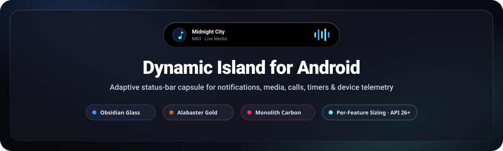
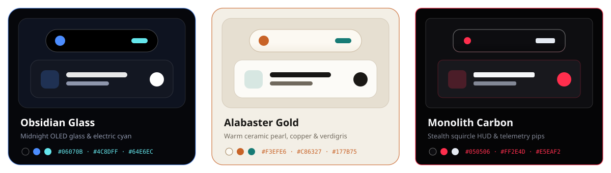
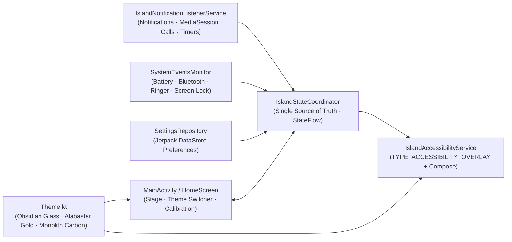

<div align="center">

<picture>
  <source media="(prefers-color-scheme: dark)" srcset="docs/assets/hero-dark.svg" />
  <source media="(prefers-color-scheme: light)" srcset="docs/assets/hero-light.svg" />
  
</picture>

<br />
<br />

[-0E1119?style=for-the-badge&logo=android&logoColor=64E6EC&labelColor=06070B&color=4C8DFF)](https://developer.android.com/about/versions)
[](https://kotlinlang.org/)
[](https://developer.android.com/compose)
[](#-3-synchronized-app--island-themes)
[](https://github.com/Chaxupatel/dynamic-island/releases/latest)

**An adaptive, cutout-aware Dynamic Island experience for Android built with Jetpack Compose, Accessibility Overlays, and a deterministic coroutine state machine.**

[Download & Install](#-how-to-install-on-your-android-device) • [Themes](#-3-synchronized-app--island-themes) • [Features](#-core-features) • [Calibration](#-per-feature-size--cutout-calibration) • [Architecture](#-architecture) • [Build from Source](#-build-from-source)

</div>

---

## ✨ Overview

**Dynamic Island for Android** (`com.dynamicisland.android`) brings a fluid, spring-animated capsule directly over your Android status bar and camera punch-hole cutout—unifying live **notifications with inline reply**, **media playback with live waveform & seek scrubber**, **calls & countdown timers**, **charging status**, **Bluetooth audio popups**, and **ringer changes** into a single interactive surface.

Everything in the app—the live interactive hero stage, the theme engine, and the system-wide status-bar overlay—runs off one deterministic state coordinator (`IslandStateCoordinator`) persisted via Jetpack DataStore.

---

## 🎨 3 Synchronized App & Island Themes

Switching a theme in the **Visual Identity** selector transforms **both** the control dashboard (surfaces, borders, cards, sliders, switches, status-bar icons) and the live **status-bar Dynamic Island overlay** in real time:

<div align="center">
  
</div>

| Theme | Aesthetic | App Canvas & Surfaces | Accents | Island Geometry & Behavior |
| :--- | :--- | :--- | :--- | :--- |
| **Obsidian Glass** *(Default)* | Midnight OLED luxury glass | `#06070B` canvas, `#131722` glass cards (`24.dp`), translucent frosted rims | Cobalt `#4C8DFF` & Electric Cyan `#64E6EC` | Pitch-black capsule (`#000000`) with subtle top specular rim (`0.8.dp`) |
| **Alabaster Gold** | Daylight ceramic editorial | `#F3EFE6` warm ivory canvas, `#FCFBF7` cards (`22.dp`), dark system status-bar icons | Brushed Copper `#C86327` & Verdigris Teal `#177B75` | **Satin Champagne Pearl** capsule (`#FCF9F2` → `#EAE2D3`) with metallic bevel border (`1.1.dp`) |
| **Monolith Carbon** | Stealth hardware tactical HUD | `#050506` void canvas, `#0E0E11` flat graphite panels (`12.dp` / `8.dp` tiles) | Signal Crimson `#FF2E4D` & Stark Silver `#E5EAF2` | Matte carbon capsule (`#0D0D10` → `#040405`), precision squircle corners (`0.54x` corner scale), and **idle telemetry pips** when visible while idle |

---

## 🚀 Core Features

- **🔔 Live Notifications & Quick Reply**:
  - Compact heads-up capsule shows sender avatar/app icon and title; tap or swipe down to expand into full message body with notification actions and **inline `RemoteInput` reply** directly from the overlay.
- **🎵 Music & Media Visualizer**:
  - Automatically syncs with active Android `MediaSession` playback—displaying album art, track title, artist, animated frequency waveform bars, live progress position, interactive seek scrubber, and Previous / Play-Pause / Next controls.
- **📞 Calls & Live Timers (+ Dual Split-Pill Mode)**:
  - Tracks ongoing calls and countdown timers with live chronometers. When two activities run together (e.g., music + timer or call + media), the Island splits into a **primary capsule + secondary detached mini-pill**.
- **⚡ Battery, Bluetooth & Silent Mode Popups**:
  - Instant transient popups for charger plug-in (`AC`, `USB`, `Wireless`, fast-charging status & battery %), Bluetooth headphones/watches/speakers (`BLUETOOTH_CONNECT`), and ringer changes (`SILENT`, `VIBRATE`, `NORMAL`) with configurable auto-dismiss duration (`2s`–`8s`).
- **🧪 Interactive Live Preview Lab & Pin Preview**:
  - Built directly into the dashboard with a synchronized mini phone stage above the controls. Toggle **Pin Preview** ON to lock any preview activity on screen indefinitely while dialing in sizes or comparing themes.
- **👁️ Smart Visibility Controls**:
  - **Hide When Idle**: Completely hides the status-bar overlay when nothing is active (no empty pill left behind).
  - **Hide in Landscape**: Automatically collapses out of the way during fullscreen videos and games.
  - **Show on Lockscreen**: Optionally keeps live activities accessible on the lockscreen.
- **✋ Fluid Gesture Controls**:
  - **Tap** compact pill to expand · **Swipe down** on compact pill to expand · **Swipe up** on expanded card to collapse · **Swipe left / right** to cycle through active activities or dismiss popups · **Long press** to launch the source app cleanly.

---

## 🎛️ Per-Feature Size & Cutout Calibration

Every Android phone has a different camera cutout width, status bar height, and screen density. Under **Precision Fit → Size & Cutout Calibration**, you can independently adjust **Width**, **Height**, and **Expanded Width** for **each individual feature**:

`Idle Pill` · `Notification` · `Music` · `Charging` · `Bluetooth` · `Timer` · `Call` · `Silent / Ring`

| Control | Range | Description |
| :--- | :--- | :--- |
| **Per-Feature Width** | `40 dp` – `380 dp` | Compact / popup capsule width for the selected feature |
| **Per-Feature Height** | `16 dp` – `90 dp` | Capsule height so it cleanly covers tall or wide punch-hole cutouts |
| **Per-Feature Expanded Width** | `220 dp` – `400 dp` | Expanded card width per feature |
| **Horizontal Offset (X)** | `-160 dp` – `+160 dp` | Align left/right with off-center camera cutouts |
| **Vertical Offset (Y)** | `-20 dp` – `+80 dp` | Nudge up/down into the status bar safe zone |
| **Corner Radius** | `8 dp` – `48 dp` | Adjust roundness from squircle pill to full capsule |
| **Popup Auto-Dismiss** | `2.0 s` – `8.0 s` | Timeout for charging, Bluetooth, and ringer popups |

---

## 📱 How to Install on Your Android Device

### Requirements
- **Android 8.0 (API 26)** or higher (compiled & targeted for **Android 15 / API 35**)

### Option 1: Direct APK Install on Your Phone (Easiest)

1. Open the [**Releases**](https://github.com/Chaxupatel/dynamic-island/releases/latest) page on your Android phone.
2. Download the latest `.apk` file (e.g., `dynamic-island-v1.0.0-debug.apk`).
3. Tap the downloaded file and allow **Install unknown apps** for your browser/file manager if prompted, then tap **Install**.

### Option 2: Install via ADB from Computer

With **USB Debugging** (or **Wireless Debugging**) enabled on your Android device:

```bash
# Verify your device is connected
adb devices

# Install the downloaded APK
adb install -r path/to/dynamic-island-v1.0.0-debug.apk
```

---

### 🔐 First-Launch Permissions & Setup

Open **Dynamic Island** after installing and grant the access tiles in the **Permissions & Services** card:

| Service / Permission | Purpose | Required? |
| :--- | :--- | :--- |
| **Accessibility Overlay** (`Dynamic Island Overlay`) | Draws the Dynamic Island capsule over the status bar and camera cutout across apps *(does not read screen text or passwords)* | **Required** |
| **Notification & Media Access** (`Dynamic Island Notifications & Media`) | Powers live notifications, inline reply, media playback controls, calls, and timers | **Required** for live events |
| **Bluetooth Devices** (`BLUETOOTH_CONNECT`) | Shows earbuds, headphones, and watch connection popups with battery level *(Android 12+)* | Optional |
| **Post Notifications** (`POST_NOTIFICATIONS`) | Optional Android 13+ notification permission | Optional |

> **Tip for Xiaomi / Vivo / Oppo / Realme / Samsung devices**: If Android blocks Accessibility or Notification Listener access for a sideloaded APK on Android 13+, open **Settings → Apps → Dynamic Island → ⋮ (top-right menu) → Allow restricted settings**, then enable the services inside **Accessibility** and **Notification access**.

---

## 🏗️ Architecture



### Project Structure

```text
app/src/main/java/com/dynamicisland/android/
├── DynamicIslandApp.kt                 # App container & shared singletons
├── model/IslandModels.kt               # Activities, IslandThemeId, FeatureSizeSpec, IslandSettings
├── core/
│   ├── IslandStateCoordinator.kt       # Deterministic state machine & priority/split-pill engine
│   └── PermissionHelper.kt             # Accessibility, NotificationListener, Bluetooth & PostNotification checks
├── data/SettingsRepository.kt          # DataStore preferences & per-feature sizing persistence
├── service/
│   ├── IslandAccessibilityService.kt   # TYPE_ACCESSIBILITY_OVERLAY window host & orientation observer
│   ├── IslandNotificationListenerService.kt # Notifications, RemoteInput reply, MediaController & timers
│   ├── SystemEventsMonitor.kt          # Charging, Bluetooth & ringer broadcasts
│   └── IslandLifecycleOwner.kt         # Lifecycle/SavedState bridge for Compose inside AccessibilityService
└── ui/
    ├── theme/Theme.kt                  # IslandPalette tokens for Obsidian Glass, Alabaster Gold, Monolith Carbon
    ├── main/                           # MainActivity & HomeScreen dashboard
    └── overlay/                        # DynamicIslandOverlay, CompactIslandContent, ExpandedIslandContent, OverlayHelpers
```

---

## 🛠️ Build from Source

### Prerequisites
- **JDK 17**
- **Android SDK** (`compileSdk 35`, `minSdk 26`, `build-tools 35.0.0`)
- Android Gradle Plugin `8.7.3` · Kotlin `2.0.21`

### Clone, Test & Build

```bash
git clone https://github.com/Chaxupatel/dynamic-island.git
cd dynamic-island

# Run JVM unit tests
./gradlew testDebugUnitTest

# Build debug APK
./gradlew assembleDebug
```

Generated APK output path:
```text
app/build/outputs/apk/debug/app-debug.apk
```

Deploy directly to a connected device or emulator:
```bash
./gradlew installDebug
```

---

<div align="center">
  <sub>Built with Kotlin, Jetpack Compose & Material 3 · Designed for Obsidian Glass, Alabaster Gold & Monolith Carbon</sub>
</div>
